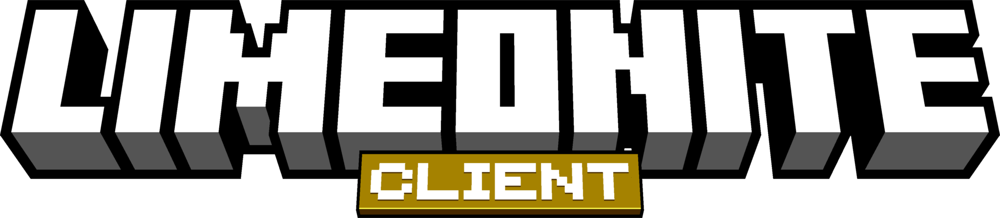
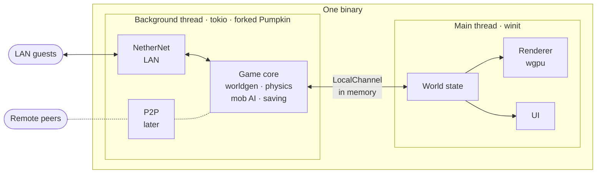

<!--
  Keep this page current (CLAUDE.md): the "current phase" alert, the milestone badge and the
  roadmap table follow docs/STATUS.md, and the numbers come from the milestone plans.
-->

<div align="center">



**A Minecraft: Bedrock Edition client, written in Rust from scratch,<br>with a forked [Pumpkin](https://github.com/Pumpkin-MC/Pumpkin) server built in for singleplayer.**

[](https://www.rust-lang.org/)
[](#the-pumpkin-fork)
[](#what-youll-need)
[](LICENSE)
<br>
[](#roadmap)
[](#how-its-made)
[](https://github.com/Doodle-Studios/limonite-client/commits/main)

[**What it is**](#what-limonite-is) · [**Try it**](#try-it) · [**How it works**](#how-it-works) · [**Roadmap**](#roadmap) · [**Docs**](#documentation)

</div>

> [!WARNING]
> **Limonite is under heavy construction, so expect little to no functionality.** Today you can
> fly around a singleplayer world drawn with vanilla textures, and that's it: no lighting, sky,
> mobs or HUD yet.

> [!IMPORTANT]
> **Current phase of development: [Milestone 5, playable singleplayer](docs/milestones/m5-plan.md).**
> The host stops being a flying camera. It walks with gravity and collision, breaks and places
> blocks, sees mobs move smoothly and the world lit by the sun and by torches, and gets a HUD, an
> inventory and a world list.

> [!WARNING]
> **Limonite is developed AI-first.** Its code, plans and docs are written by **Claude Opus 5.5**
> at Extra, Max or Ultracode effort, and nearly every commit is co-authored by Claude. The owner
> steers: each milestone's plan is approved before any code is written, and each milestone is
> accepted by the owner, checked against the official Bedrock client.

## What Limonite is

Limonite Client is a Bedrock Edition client written in Rust and shipped as **one binary**. For
singleplayer it runs its own fork of [Pumpkin](https://github.com/Pumpkin-MC/Pumpkin), the Rust
Minecraft server, on a background thread, and joins it as the host through memory instead of a
socket.

The work splits cleanly: the client renders, predicts and presents, while the embedded server owns
world generation, physics, mob AI and saving. Nothing Pumpkin already does gets rebuilt.

<table>
<tr>
<td width="50%" valign="top">


**Zero network overhead**

In singleplayer the client and its server share one process and talk through an in-memory
channel: no sockets, encryption, compression or fragmentation in between.

<sub><b>WORKS TODAY</b></sub>

</td>
<td width="50%" valign="top">


**Open to LAN, mid-game**

Open a running world to your LAN without the host losing performance.

<sub>PLANNED · MILESTONE 7</sub>

</td>
</tr>
<tr>
<td width="50%" valign="top">


**Squeeze the GPU**

GPU-driven rendering, hardware ray tracing where the hardware has it, and honest performance
warnings where it doesn't.

<sub>PLANNED · MILESTONES 6 AND 10</sub>

</td>
<td width="50%" valign="top">


**Resource and shader packs**

Bedrock resource packs, plus drag-and-drop Iris shader packs made for Java Edition.

<sub>PLANNED · MILESTONES 8 AND 9</sub>

</td>
</tr>
<tr>
<td width="50%" valign="top">


**Your game, your files**

Vanilla textures are read at runtime from your own Bedrock install: never copied, cached or
shipped.

<sub><b>WORKS TODAY</b></sub>

</td>
<td width="50%" valign="top">


**Peer-to-peer joining**

The same transport seam can later carry Mojang-style P2P joining over NetherNet, Bedrock's WebRTC
transport.

<sub>PLANNED · MILESTONE 11</sub>

</td>
</tr>
</table>

### What works today

Milestones 0 to 4 are done. Here's what they built:

- **A window onto a real world.** Fly the host around a world the embedded server generates,
  drawn with wgpu. Chunks load as you fly, and drop once the server's view has left them.
- **Vanilla textures from your install.** The `packs` crate stacks all 55 vanilla resource packs
  at runtime, from loose folders and `__brarchive` archives alike.
- **Bedrock-native world state.** Chunks decode straight into Bedrock's own palette format, and
  the client's world equals the server's, block for block and biome for biome. That's checked on
  all 3,725 chunks of a radius-32 view.
- **No sockets in singleplayer.** The host logs in and plays over `LocalChannel`, and the process
  owns no TCP or UDP socket while it does.
- **Byte-exact packets.** What the client sends re-encodes byte for byte against captures from the
  official client.
- **A faster server.** The fork encodes Bedrock chunks 4.8× faster, in 145 µs per chunk instead of
  696, with byte-identical output.
- **A baseline to beat.** 2,794, 1,016 and 166 fps at radius 8, 16 and 32, in a release build on
  the dev machine. The GPU-driven renderer has to beat it.

## Try it

> [!NOTE]
> There are no releases yet, so you build Limonite from source. Today's build compiles Mojang's
> vanilla Java datapack into the binary and embeds the Bedrock block palette, so no binaries will
> be shared until that's solved ([PLAN.md, Risks](docs/PLAN.md#risks-open-questions-references)).

### What you'll need

- **Windows.** It's the only platform Limonite has been tested on so far (Windows 11).
- **Minecraft: Bedrock Edition**, installed the usual way, so that it lands in
  `<drive>:\XboxGames\Minecraft for Windows`. Limonite reads the vanilla textures from it while it
  runs. Headless mode doesn't need it.
- **[Rust](https://rustup.rs/)**, stable 1.96 or newer. The repo's `rust-toolchain.toml` picks
  stable for you.
- **The MSVC C++ build tools** (Visual Studio 2022, or its Build Tools), which Rust needs on Windows
  anyway.
- **Git**, with long paths turned on for the Pumpkin submodule: some of its paths are longer than
  Windows allows by default.
- **An internet connection for the first build.** Pumpkin's build script downloads the Minecraft
  Java 26.3 server jar from Mojang, to extract the vanilla datapack. To use a jar you already have,
  point `PUMPKIN_MINECRAFT_SERVER_JAR` at it.

### Build and run

```bash
git clone https://github.com/Doodle-Studios/limonite-client
cd limonite-client
git -c core.longpaths=true submodule update --init
git -C pumpkin config core.longpaths true
cargo run -p limonite-client
```

The first build takes a few minutes. Then a window opens on a singleplayer world, run by the
embedded server, and you fly around it as the host. Closing the window saves the world.

> [!TIP]
> For the best frame rates, use a release build: `cargo run --release -p limonite-client`. Its
> fat-LTO link is slow, and [STATUS.md](docs/STATUS.md#dev-environment) shows how to skip it.

### Controls

| Key | What it does |
| --- | --- |
| <kbd>Click</kbd> | Captures the mouse, so you can look around |
| <kbd>W</kbd> <kbd>A</kbd> <kbd>S</kbd> <kbd>D</kbd> | Fly |
| <kbd>Space</kbd> / <kbd>Left Shift</kbd> | Up / down |
| <kbd>Left Ctrl</kbd> (hold) | Fly three times faster |
| <kbd>Esc</kbd> | Releases the mouse |
| <kbd>P</kbd> | Logs where you are as a `/tp` command |

The title bar shows the frame rate and frame time, the chunk and mesh counts, the draw calls and
your position.

<details>
<summary><b>Command-line flags</b></summary>
<br>

| Flag | What it does |
| --- | --- |
| `--bedrock <path>` | Where Bedrock is, if it isn't in the usual place: the folder that holds `data/resource_packs` |
| `--data-dir <path>` | Where the world is kept (default `run/client`) |
| `--name <name>` | The host's display name (default `Limonite`) |
| `--gamemode <mode>` | The host's gamemode in a new world: `survival`, `creative` (the default), `adventure` or `spectator` |
| `--radius <chunks>` | The view distance to ask for, 2 to 32 (default 8) |
| `--bench <seconds>` | Flies east for that long and logs frame times; use a release build |

</details>

<details>
<summary><b>Headless mode: the scripted checks</b></summary>
<br>

`--headless` runs the older scripted session instead, with no window, no GPU and no Bedrock install
needed. The client joins as the host, walks 8 blocks east, checks that the world it decoded equals
the server's own, block for block, and exits. Each check prints one `PASS` or `FAIL` line, and the
exit code is non-zero if any of them fails.

```bash
cargo run -p limonite-client -- --headless --map run/m3/map.png
```

| Flag (with `--headless`) | What it does |
| --- | --- |
| `--map <path.png>` | Writes a top-down map of the loaded chunks: one pixel per block column, north up, Java map colours, the host marked with a red cross |
| `--linger <seconds>` | Stays in the world afterwards |
| `--measure` | Logs what the in-process channel costs, chunk encode and decode split into phases, and how fast a block change reaches the client; only meaningful in a release build |
| `--stream <blocks>` | After joining, flies that many blocks east at creative flying speed and logs how fast new chunks arrive |

`--data-dir`, `--name`, `--gamemode` and `--radius` work here too.

</details>

**Good to know**

- **Your world carries over.** Each run starts where the last one ended. Delete `run/client/` for a
  fresh world.
- **Logging:** `RUST_LOG` picks what gets logged. `RUST_LOG=info,limonite_client=debug` also logs
  every packet the client receives.
- **Rebuilding:** on Windows, a running client locks its `.exe`, so close the window before you run
  `cargo build`.
- **More:** setup details, build times and the gotchas that bite are in
  [STATUS.md](docs/STATUS.md).

## How it works

One process, two threads, one seam. The main thread runs the window, renderer and UI, and a
background thread runs the forked Pumpkin server. They meet only at the `Transport` trait, so the
server doesn't know or care whether a player is the host in the same process, a LAN guest or a
future peer.



- **The client holds a picture of the world, never the truth.** The server decides what exists, and
  the client predicts and draws. World state is the wall between them: the renderer never touches
  packets, and the transport never touches the GPU.
- **Bytes, not structs.** Pumpkin turns each packet into bytes in game code, so the host's channel
  carries the same Bedrock packets a LAN guest gets, minus compression, encryption and
  fragmentation. Passing structs would mean rewriting 54 call sites in Pumpkin, and a zero-copy
  path for chunks was measured to save under 1% of a core, so bytes stay.
- **One protocol definition.** The client uses Pumpkin's own Bedrock packet types, with client-side
  codecs added in the fork, so the two sides can never disagree on a protocol version.

| Transport | When it's active | What it carries |
| --- | --- | --- |
| `LocalChannel` | Always, for the host | Uncompressed Bedrock packets over in-memory channels: no WebRTC, encryption, fragmentation, compression or authentication |
| NetherNet | While LAN is open (milestone 7) | Compressed batches over DTLS-encrypted WebRTC data channels: Bedrock's own LAN transport, already in Pumpkin |
| P2P | Later (milestone 11) | NetherNet with Limonite's own signalling server and a TURN fallback |

### The Pumpkin fork

Limonite embeds [Doodle-Studios/Pumpkin](https://github.com/Doodle-Studios/Pumpkin/tree/limonite),
branch `limonite`, as a git submodule. Upstream Pumpkin's Bedrock support speaks NetherNet and
accepts exactly one protocol: **Bedrock 1.26.51, protocol 2193**.

The fork stays small on purpose. Changes to existing Pumpkin files only go through small, named
seams, each with a doc comment saying why it exists, so rebasing onto upstream stays cheap.

**What the fork adds**

- A `Transport` trait: the one seam where a player's packets enter and leave the server.
- `LocalChannel`, the host's in-memory transport, which binds nothing.
- An opt-in `java-listener` feature, so the client compiles the Java Edition listener out and can
  never bind a Java socket.
- Client-side packet codecs in `pumpkin-protocol`, behind a `client` feature.
- A 4.8× faster Bedrock palette conversion, with byte-identical output.

**What it leaves alone:** world generation, physics, mob AI, ticking, chunk storage, saving and
commands.

Fixes that would help upstream are kept upstreamable, and the candidates are listed in
[STATUS.md](docs/STATUS.md#upstream-pr-candidates).

### Repository layout

```
limonite-client/          # cargo workspace
├── client/               # the binary: window, renderer, world state, input, embedded server
│   └── src/
│       ├── blocks/       # the block palette, and how each block looks
│       ├── render/       # wgpu device, camera, mesher, textures, terrain shader
│       └── world/        # Bedrock-native chunks and their decoder
├── packs/                # the pack filesystem: vanilla stack, __brarchive, registry merging
├── pumpkin/              # the Pumpkin fork, as a git submodule
└── docs/                 # the plan, status, milestone plans and recon notes
```

Later milestones add `molang/`, `iris-compat/` and `mappings/` crates.

## Roadmap

Each milestone ends in something runnable, and is done only when its acceptance check passes.

| Status | Milestone | What it delivers | Docs |
| --- | --- | --- | :-: |
| Done | **0 · Recon** | How Pumpkin talks to Bedrock, mapped, with the official client joining the stock fork | [recon](docs/recon/m0-pumpkin-bedrock.md) |
| Done | **1 · Workspace and fork seam** | The workspace, the fork as a submodule, the `Transport` trait, and the Java listener compiled out | [plan](docs/milestones/m1-plan.md) |
| Done | **2 · Headless embedded client** | Pumpkin on a background thread, and the host joining it over `LocalChannel` with no socket | [plan](docs/milestones/m2-plan.md) |
| Done | **3 · Chunk map** | Chunks decoded into Bedrock-native world state, and a top-down map that matches the official client | [plan](docs/milestones/m3-plan.md) |
| Done | **4 · First pixels** | A window, a fly camera, and terrain drawn with vanilla textures from your install | [plan](docs/milestones/m4-plan.md) |
| **Current** | **5 · Playable singleplayer** | Physics, breaking and placing, client lighting, mobs, a HUD, an inventory and a world list | [plan](docs/milestones/m5-plan.md) |
| Planned | **5b · Containers** | Crafting, chests and furnaces | |
| Planned | **6 · GPU-driven renderer** | Compute meshing, GPU culling, indirect draws, capability tiers, and a benchmark with honest warnings | |
| Planned | **7 · Open to LAN** | NetherNet started and stopped live, from inside a running world | |
| Planned | **8 · Resource packs** | Full pack stacking, flipbooks, Molang, entity models and animations, sounds and hot reload | |
| Planned | **9 · Iris packs** | Java Edition shader packs, translated to SPIR-V | |
| Planned | **10 · Extras** | Native ray tracing, a JSON UI subset, server forms, Java pack import and particles | |
| Planned | **11 · P2P** | Joining across networks with no port forwarding | |

<sub>Milestones 0 to 4 landed between 2026-10-19 and 2026-10-24.</sub>

## How it's made

Limonite is built AI-first, one milestone at a time:

1. **Plan.** Claude reads the code and writes the milestone's plan. The owner amends it and
   approves it, and it's kept in [docs/milestones](docs/milestones).
2. **Build.** Claude builds it step by step, in small commits split by concern, and records every
   deviation from the plan as it goes.
3. **Accept.** The owner checks the result against the official Bedrock client, and only then is
   the milestone ticked in [PLAN.md](docs/PLAN.md).

The rules Claude works by are in [CLAUDE.md](CLAUDE.md).

## Principles

1. **Seams over spaghetti.** Every change to Pumpkin goes through a small, named seam, so upstream
   rebases stay cheap.
2. **Detect capabilities, never brands.** A GPU feature flag decides a code path; a vendor name
   never does.
3. **Measure, don't guess.** Performance tiers come from timed frames, not GPU names.
4. **The official client is the ground truth.** Packets are golden-tested against its bytes, and
   what the client draws is compared side by side with it.
5. **Shared cores first.** The pack filesystem, the Molang interpreter and the Java-to-Bedrock
   mapping table feed most features, so they get built well and early.
6. **Log everything.** `tracing` from day one, because a bug can live in the client, the fork or a
   pack.

## Scope and ground rules

Limonite is for your own worlds and your own LAN.

- **No Mojang assets or third-party packs in the repo or the binary.** Vanilla assets are only
  ever read at runtime from your own install.
- **Not for public servers or Realms.** Custom clients can trip anti-cheat or break terms of
  service, so Limonite is only tested on its embedded server and its owner's LAN.
- **No Marketplace decryption.** Encrypted packs aren't supported, and never will be.
- **No Java Edition networking.** The fork's Java listener is compiled out of the client.

## Documentation

| Document | What's in it |
| --- | --- |
| [PLAN.md](docs/PLAN.md) | The design, and the source of truth: architecture, the fork's seams, the renderer, packs, UI, milestones and risks |
| [STATUS.md](docs/STATUS.md) | Where the project stands, the dev setup, build times and gotchas |
| [milestones/](docs/milestones) | Each milestone's approved plan, with its results and deviations |
| [m0-pumpkin-bedrock.md](docs/recon/m0-pumpkin-bedrock.md) | How Pumpkin talks to Bedrock clients; read it before touching the fork |
| [CLAUDE.md](CLAUDE.md) | The working rules for the AI agent that develops Limonite |

The same documents are on the [wiki](https://github.com/Doodle-Studios/limonite-client/wiki), with
a sidebar for getting around. It's generated from `docs/` by `scripts/sync-wiki.ps1`, so edit the
files here, not the wiki.

## Acknowledgements

Limonite stands on the work of others:

- **[Pumpkin](https://github.com/Pumpkin-MC/Pumpkin)**, the Rust Minecraft server at its heart
  ([pumpkinmc.org](https://pumpkinmc.org/)).
- **[wgpu](https://github.com/gfx-rs/wgpu)** and **[winit](https://github.com/rust-windowing/winit)**,
  for the GPU and the window.
- **[Mojang's bedrock-samples](https://github.com/Mojang/bedrock-samples)**, the reference for
  vanilla pack formats.
- **[bedrock-rs](https://github.com/bedrock-crustaceans/bedrock-rs)**,
  **[gophertunnel](https://github.com/Sandertv/gophertunnel)** and
  **[PrismarineJS bedrock-protocol](https://github.com/PrismarineJS/bedrock-protocol)**, for
  reading Bedrock's protocol.
- **[GeyserMC](https://github.com/GeyserMC)** and **[CloudburstMC](https://github.com/CloudburstMC)**,
  for Java-to-Bedrock mappings and the Bedrock block-state data.
- **[Iris](https://github.com/IrisShaders/Iris)**, the reference for how shader packs behave.
- **[Blockbench](https://www.blockbench.net/)** and its Minecraft Title Generator plugin, for the
  logo. Its model is [`docs/readme/models/title.bbmodel`](docs/readme/models/title.bbmodel).

## Licence

Limonite Client is licensed under the [GNU General Public License v3.0](LICENSE). It embeds a
modified fork of Pumpkin, which is GPL-3.0 as well.

<div align="center">
<br>
<sub>Limonite is not an official Minecraft product, and is not approved by or associated with Mojang or Microsoft.</sub>
</div>
